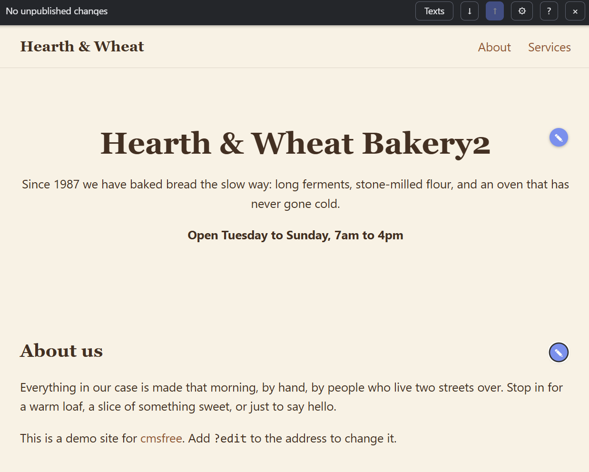
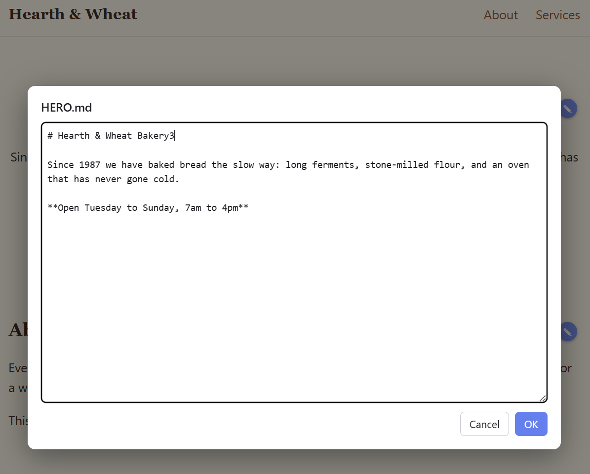
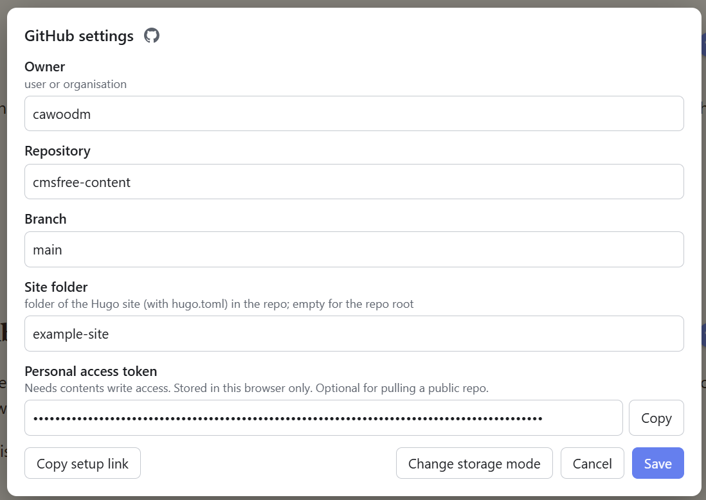

# cmsfree ✎

**A tiny CMS with no backend.** Edit your static site in the browser. Your edits are plain Markdown files which you publish to GitHub; the site's own build renders (e.g. with Hugo) and deploys them.

Add `?edit` to any page and a dormant script (`cms.js`) wakes up, loads the site's content files and turns the live page into an editor. Without `?edit` it does nothing.





## Publishing

CMSFree just writes markdown files to your github when you publish. What you do with that is up to you but you would typically have a github action which builds and publishes your HTML site.

Hugo is a neat way of converting (building) that content to a website. Under `samples/` you will see 2 examples of plain [Hugo](https://gohugo.io) sites. We ships three small partials that mark the editable output and make it work.

## Setup

Add cms.js to your site and setup placeholders as described in our samples. Then open your site with `?edit` and click the config icon to link your github repo where your content will live:



```
your-site/
  hugo.toml
  layouts/home.html                  page template
  layouts/_partials/cms-*.html       cmsfree partials (hugo/layouts/_partials/)
  content/blocks/NAME.md             Markdown blocks (NAME.<lang>.md in other languages)
  i18n/<lang>.yaml                   short strings
  static/cms.js                      the cmsfree editor (this repo's dist/cms.js)
```

See [docs/FORMAT.md](docs/FORMAT.md) for the format and the edit markers.

## Storage modes

While you are editing, your content is stored in the browser by default. On desktop clients however, you can actually connect a local folder and CMSFree will write the markdown to disk. This is great for managing a local markdown library like a private wiki.

- **Browser** (default): edits live in the browser (OPFS), synced with the GitHub repo. **Publish** makes one commit; your site's build deploys it.
- **Folder** (Chromium only): pick a local clone of the site repo. Edits are written there; commit with git.

## Try the example

```bash
npm install                  # Hugo (0.147+) must be on the PATH
npm run dev                  # renders both examples, serves samples/example-site at http://localhost:5173/
npm run dev:multilingual     # serves samples/example-site-multilingual (/en/, /de/)
```

Open **http://localhost:5173/?edit** (multilingual: **/en/?edit**) and choose **Use local folder**, then pick `samples/example-site/` (or `samples/example-site-multilingual/`). Edits are written to its `content/` and `i18n/`; run `npm run build:examples` to render them.

```bash
npm run build          # bundle the editor -> dist/cms.js (copy it to a site's static/cms.js)
npm run preview        # serve samples/example-site/dist on a plain static server
```

---

_Made for people who want to edit their own site without a dashboard, an account, or a backend._
